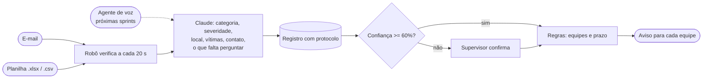

# Robô de triagem de ocorrências rodoviárias

**RPA · Sprint 1: receber, entender e encaminhar**

Automatizamos o caminho das ocorrências que chegam por escrito ao Centro de Controle Operacional (CCO) de uma concessionária de rodovias (Motiva). Um relato chega por e-mail ou numa planilha. O robô captura, o Claude lê o texto e extrai os dados (o que aconteceu, onde, gravidade, vítimas, contato), o sistema grava com protocolo e avisa as equipes certas com prazo de atendimento. Deixamos pronta também a função que o agente de voz vai chamar nas próximas sprints.

**Grupo:** Gabriel Muniz (568237), Leonardo Barros (566788), Marcelo Augusto (567176), Rafael Tavares (567357), Yuri Quirino (568512)

## Entregas

| O que o enunciado pede | Onde está |
|---|---|
| Captura automática por e-mail e por arquivo (Excel ou CSV) | [`motiva_rpa/captura_email.py`](motiva_rpa/captura_email.py), [`motiva_rpa/captura_arquivo.py`](motiva_rpa/captura_arquivo.py) |
| IA classifica a solicitação e extrai os dados do registro | [`motiva_rpa/ia.py`](motiva_rpa/ia.py) |
| Registro estruturado e encaminhamento automático ao responsável | [`motiva_rpa/registro.py`](motiva_rpa/registro.py), [`motiva_rpa/encaminhamento.py`](motiva_rpa/encaminhamento.py), [`config/responsaveis.json`](config/responsaveis.json) |
| Função que o agente de voz possa chamar | [`motiva_rpa/voz.py`](motiva_rpa/voz.py) |
| Desenho do processo antes e depois | [`docs/processo.md`](docs/processo.md) |
| Vídeo curto da demonstração | link: *(colocar aqui o link do vídeo)* · roteiro em [`docs/roteiro_video.md`](docs/roteiro_video.md) |

## O processo

Hoje (no nosso entendimento de como funciona um CCO), e-mails e planilhas de relatos caem numa caixa compartilhada. Um atendente lê quando tem tempo, tenta entender onde e o que aconteceu, digita no sistema e decide de cabeça qual equipe chamar. No pico, quando o telefone não para, um "pneu na faixa" pode esperar muito para ser lido, e um acidente com vítima pode ficar atrás de reclamações de pedágio.

Com o robô, toda mensagem é lida em segundos e já sai com severidade, local estruturado e as equipes acionadas. O humano continua decidindo nos casos em que a IA não tem certeza.



O antes e depois completos, com os problemas de cada etapa e a tabela de encaminhamento, estão em [`docs/processo.md`](docs/processo.md).

## Como funciona

Toda solicitação, venha de onde vier, passa pela mesma função, `pipeline.processar()`. Cada canal de captura só precisa transformar o que chegou em texto e chamar essa função. Foi assim que a função do agente de voz entrou sem mudar nada no resto.

| Módulo | O que faz |
|---|---|
| `captura_email.py` | Lê uma caixa de e-mail temporária do [Guerrilla Mail](https://www.guerrillamail.com) pela API, sem cadastro. Corta o histórico citado ("Em ... escreveu:"). Planilha anexada vai para a pasta de entrada. |
| `captura_arquivo.py` | Olha a pasta `entrada/`. Cada linha de `.xlsx` ou `.csv` vira uma solicitação; as outras colunas (nome, telefone, data) vão junto como contexto para a IA. O arquivo processado vai para `entrada/processados/`. |
| `ia.py` | Manda o texto para o Claude e recebe a classificação num formato fixo. |
| `registro.py` | Grava em SQLite com protocolo `OC-AAAAMMDD-NNNN` e exporta para Excel. |
| `encaminhamento.py` | Escolhe as equipes por regra, calcula o prazo e entrega o aviso. |
| `voz.py` | Funções e definições para o agente de voz. |

O mesmo e-mail ou a mesma linha de planilha nunca gera dois registros: cada solicitação guarda a referência de onde veio, e o robô confere antes de processar.

## A IA

Usamos o **Claude Opus 5.5** (`claude-opus-5-5`) pela API da Anthropic, com esforço baixo, porque classificar uma mensagem curta não precisa de raciocínio longo.

**O que ela devolve.** A resposta é presa a um JSON Schema (*structured outputs*), então o robô sempre recebe os mesmos campos, mesmo quando o relato é bagunçado ou cheio de erros de digitação:

- categoria (acidente, veículo avariado, objeto na pista, animal na pista, pedestre na pista, problema na via, evento ambiental, atendimento ao usuário, não é ocorrência) e um subtipo em texto livre;
- severidade (crítica, alta, média, baixa) e se há risco à vida;
- local (rodovia, km, sentido, referência), veículos envolvidos, vítimas, se a pista está bloqueada;
- nome, telefone e e-mail de quem relatou;
- **informações faltantes**: o que a equipe precisa confirmar com quem relatou ("quilômetro exato", "se há vítimas");
- **confiança** de 0 a 1 e uma justificativa de uma frase.

O prompt ([`motiva_rpa/ia.py`](motiva_rpa/ia.py)) define o critério de cada severidade e proíbe inventar dados: campo que não está na mensagem fica vazio.

**Onde a IA não decide.** Quem escolhe a equipe é uma tabela de regras sobre os campos extraídos, não o modelo. Assim a operação consegue ler e mudar o roteamento sem mexer em prompt, e o mesmo tipo de ocorrência sempre vai para o mesmo lugar.

**Human-in-the-Loop.** Se a confiança ficar abaixo de 60% ou a IA achar que a mensagem não é uma ocorrência, o caso vai para o supervisor do CCO com o aviso "confirme a classificação antes de despachar". Se a API estiver fora do ar, a solicitação é gravada assim mesmo, com status `aguardando_triagem`, e não se perde.

**Fallback do modelo.** Ligamos o *server-side fallback* da API: se o modelo recusar uma mensagem por política de segurança, a própria API repete o pedido em outro modelo.

### Resultado nos nossos testes

Rodamos o robô com a planilha de exemplo (7 relatos), três e-mails enviados de uma conta Gmail de verdade (um deles com uma planilha anexada) e uma ligação simulada. Todas as 13 solicitações foram processadas; o registro completo exportado está em [`docs/exemplo_saida/ocorrencias.xlsx`](docs/exemplo_saida/ocorrencias.xlsx).

| Relato (resumido) | Canal | Categoria / severidade | Equipes |
|---|---|---|---|
| Carro capotado, mulher presa, fumaça | planilha | acidente / crítica | CCO, resgate, guincho |
| Batida de caminhão com dois carros, motociclista no chão | e-mail | acidente / crítica | CCO, resgate, guincho |
| Pneu de caminhão na faixa da esquerda | planilha | objeto na pista / alta | inspeção, CCO |
| Carro ferveu no acostamento, com criança | planilha | veículo avariado / média | guincho |
| Buraco de 40 cm, já estourou dois pneus | planilha | problema na via / alta | conservação, CCO |
| Placa de saída caída no canteiro | e-mail | problema na via / média | conservação |
| Cobrança em dobro no pedágio | planilha | atendimento ao usuário / baixa | ouvidoria |
| Cavalo na beira da pista à noite | planilha | animal na pista / alta | inspeção, CCO |
| "Vi umas luzes piscando, não sei se é acidente ou obra" | planilha | não é ocorrência (confiança 30%) | supervisor |
| Moto atingida por carro, motociclista sangrando | voz | acidente / crítica | CCO, resgate, guincho |

Alguns detalhes que nos chamaram atenção: no pedido de estorno, a IA usou a data da planilha para transformar "ontem" em "29/10". No capotamento, o relato dizia "acho que km 132", e a primeira coisa que ela listou para confirmar foi o quilômetro.

Isso não é uma medição de acerto: são 13 casos escritos por nós. Uma avaliação de verdade precisaria de relatos reais do CCO com a classificação correta marcada por quem trabalha lá.

## Função para o agente de voz

O agente de voz vai transcrever a ligação e chamar:

| Função | Para quê |
|---|---|
| `registrar_ocorrencia_por_voz(transcricao, telefone, local_informado)` | Registra e encaminha pelo mesmo caminho do e-mail e da planilha |
| `consultar_ocorrencia(protocolo)` | Responde quem liga de novo perguntando da ocorrência |

A resposta traz o protocolo, as equipes acionadas, as perguntas que o agente ainda deve fazer e a frase que ele pode falar. Exemplo real (está em [`docs/exemplo_saida/resposta_funcao_voz.json`](docs/exemplo_saida/resposta_funcao_voz.json)):

```json
{
  "ok": true,
  "protocolo": "OC-20261030-0013",
  "categoria": "acidente",
  "severidade": "critica",
  "equipes_acionadas": ["cco", "resgate", "guincho"],
  "status": "encaminhada",
  "atender_ate": "30/10/2026 21:25",
  "perguntas_pendentes": ["quilômetro", "sentido da pista", "se a pista está bloqueada",
                          "se há outras vítimas (ocupantes do carro)", "nome do solicitante", "ponto de referência"],
  "fala_sugerida": "Já acionei o Centro de Controle, o resgate e o guincho. Se puder, fique em local seguro, longe da pista. Sua ocorrência é a de número 13 de hoje."
}
```

`voz.FERRAMENTAS_VOZ` tem as duas funções descritas no formato de *tool use* da API do Claude (nome, descrição e JSON Schema), e `voz.executar_ferramenta(nome, argumentos)` faz a chamada. Na próxima sprint o agente só precisa passar essa lista para o modelo e repassar as chamadas.

## Como rodar

Precisa de Python 3.10 ou mais novo e de uma chave da API da Anthropic.

```bash
python -m venv .venv
.venv\Scripts\activate            # Windows (no Linux/Mac: source .venv/bin/activate)
pip install -r requirements.txt
copy .env.example .env            # no Linux/Mac: cp .env.example .env
```

Coloque a chave em `ANTHROPIC_API_KEY` no `.env`. Depois:

```bash
python -m motiva_rpa criar-caixa     # cria a caixa de e-mail e mostra o endereço
python -m motiva_rpa rodar           # fica olhando e-mail e pasta entrada/ (Ctrl+C para parar)
```

Com o robô rodando, mande um e-mail para o endereço mostrado (há textos prontos em [`exemplos/emails_exemplo.md`](exemplos/emails_exemplo.md)) ou copie [`exemplos/planilha_ocorrencias_exemplo.xlsx`](exemplos/planilha_ocorrencias_exemplo.xlsx) para a pasta `entrada/`.

Outros comandos:

```bash
python -m motiva_rpa listar                       # últimas ocorrências
python -m motiva_rpa exportar                     # gera saida/ocorrencias.xlsx
python -m motiva_rpa processar-texto "tem um sofá caído na pista da Dutra km 150"
python -m motiva_rpa voz "bateram aqui na Anhanguera, tem gente machucada" --telefone 11999990000
python -m motiva_rpa consultar OC-20261030-0001
```

### Para onde vão os avisos

Todo aviso é salvo como e-mail (`.eml`) em `saida/encaminhamentos/<equipe>/`, e dá para abrir no Outlook ou em qualquer leitor de e-mail. Dois exemplos estão em [`docs/exemplo_saida/`](docs/exemplo_saida/). Para enviar de verdade, há duas opções no `.env`:

- **E-mail:** preencha `SMTP_HOST`, `SMTP_USUARIO` e `SMTP_SENHA` (no Gmail, use `smtp.gmail.com` e uma senha de app) e o e-mail de cada equipe em `config/responsaveis.json`.
- **Webhook:** cole em `WEBHOOK_URL` o endereço de webhook de um canal do Discord, Teams ou Slack.

Se um envio falhar, os outros seguem, e a falha fica registrada na aba `encaminhamentos` da planilha exportada.

### Testes

```bash
python -m pytest
```

São 15 testes que cobrem as regras de encaminhamento, a leitura de planilhas, a proteção contra duplicidade, a falha da IA e a função de voz. Eles simulam a resposta da IA, então rodam sem chave e sem custo.

## Limitações

- O "antes" do processo é o nosso entendimento de um CCO, não o procedimento real da Motiva, e os tempos dele são estimativas.
- O Guerrilla Mail é um serviço de teste: as mensagens somem depois de uma hora e a API não devolve o assunto de alguns e-mails (os que mandamos pelo Gmail chegaram sem assunto, mas com o corpo inteiro). Em produção, a captura usaria a caixa real do CCO por IMAP ou pela API do Microsoft 365.
- As regras olham uma mensagem por vez. Dois relatos do mesmo acidente viram duas ocorrências; juntar relatos parecidos fica para uma próxima sprint.
- O prazo de atendimento é calculado em minutos corridos, sem considerar turno das equipes.

## Estrutura

```
motiva_rpa/        código do robô
config/            equipes, e-mails e prazos (responsaveis.json)
exemplos/          planilha e e-mails para testar
docs/              processo antes/depois, roteiro do vídeo e exemplos de saída
tests/             testes automatizados
entrada/           pasta monitorada (planilhas novas)
saida/             registro exportado e avisos gerados
```
