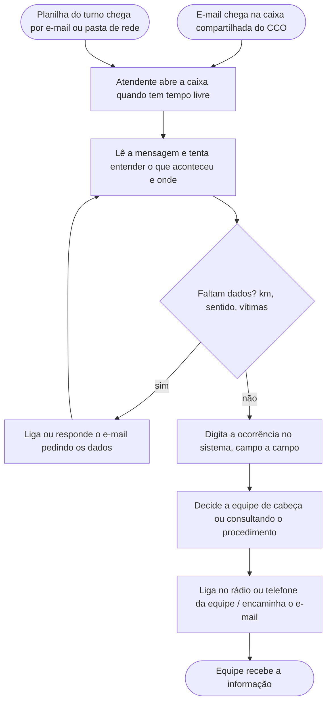
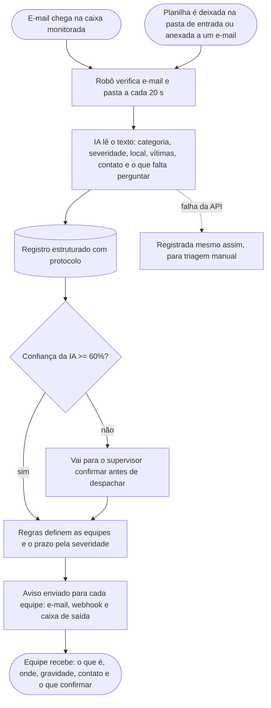

# Processo: triagem de ocorrências recebidas por escrito

## O processo escolhido

Escolhemos as ocorrências que chegam ao CCO (Centro de Controle Operacional) **por escrito**: e-mails de usuários e de outras áreas, e planilhas que as equipes consolidam com o que chegou por WhatsApp ou rádio durante o turno. As ligações para o 0800 continuam com os atendentes por enquanto e vão para o agente de voz nas próximas sprints.

Escolhemos esse processo porque ele junta três coisas que a automação resolve bem: muito volume em horário de pico, texto livre que alguém precisa ler e interpretar, e uma decisão de encaminhamento que segue regras conhecidas (acidente com vítima vai para o resgate, buraco vai para a conservação, cobrança de pedágio vai para a ouvidoria...).

Não temos acesso ao procedimento interno da Motiva. O "antes" abaixo é o nosso entendimento de como um CCO de concessionária trata o que chega por escrito. Por isso, os tempos do "antes" são estimativas nossas, não medições.

## Antes da automação

**Problemas que vemos nesse fluxo:**

| Problema | Consequência |
|---|---|
| A caixa só é lida quando o atendente está livre, e no pico ele está atendendo telefone. | Um "pneu na faixa" pode esperar dezenas de minutos para ser lido. |
| Todas as mensagens entram na mesma fila, sem prioridade. | Um acidente com vítima pode ficar atrás de três reclamações de pedágio. |
| O registro é digitado à mão a partir de texto livre. | Erro de digitação no km ou no sentido manda a equipe para o lugar errado. |
| A escolha da equipe depende da experiência de quem está no turno. | O mesmo tipo de ocorrência é tratado de formas diferentes. |
| A planilha do turno é processada linha a linha, no fim do turno. | Ocorrências do começo do turno chegam com horas de atraso. |

Tempo estimado por solicitação, do momento em que chega até a equipe saber: **10 a 40 minutos**, dependendo do movimento no CCO.

## Depois da automação

**O que muda:**

| Antes | Depois |
|---|---|
| Fila única, lida quando dá. | Toda mensagem é lida em até 20 segundos e já sai com severidade. |
| Atendente digita o registro. | A IA preenche os campos; o texto original fica guardado junto. |
| A equipe é escolhida de cabeça. | A equipe sai de uma tabela de regras que a operação pode auditar e mudar. |
| Dado faltando gera retrabalho. | O aviso já diz o que a equipe precisa confirmar com o solicitante. |
| Planilha processada no fim do turno. | Cada linha vira uma ocorrência assim que o arquivo aparece. |

**Onde o humano continua decidindo:**

- **Baixa confiança:** quando a IA não tem certeza (confiança abaixo de 60%) ou a mensagem não parece uma ocorrência, o caso vai primeiro para o supervisor, com o aviso "confirme a classificação antes de despachar".
- **Falha da API:** se a IA ficar fora do ar, a solicitação é registrada assim mesmo, com status `aguardando_triagem`. Nada se perde.
- **Regras auditáveis:** quem decide qual equipe atende é a tabela de regras (`config/responsaveis.json` e `motiva_rpa/encaminhamento.py`), não o modelo. Assim a operação consegue auditar e ajustar o roteamento sem mexer na IA.

## Tabela de encaminhamento

| Categoria (definida pela IA) | Equipes acionadas | Observação |
|---|---|---|
| Acidente | CCO, guincho; resgate se houver vítima ou risco à vida | |
| Veículo avariado | Guincho; CCO se a pista estiver bloqueada ou a severidade for alta | |
| Objeto ou animal na pista | Inspeção de tráfego; CCO se a severidade for alta ou crítica | |
| Pedestre na pista | Inspeção de tráfego e CCO | |
| Problema na via (buraco, placa, iluminação) | Conservação; CCO se for grave | |
| Evento ambiental (incêndio, alagamento, queda de barreira) | CCO | |
| Atendimento ao usuário (pedágio, reclamação) | Ouvidoria | |
| Não é ocorrência ou baixa confiança | Supervisor (triagem) | |

O prazo de atendimento sai da severidade (crítica, alta, média, baixa) e da equipe, conforme `config/responsaveis.json`.
